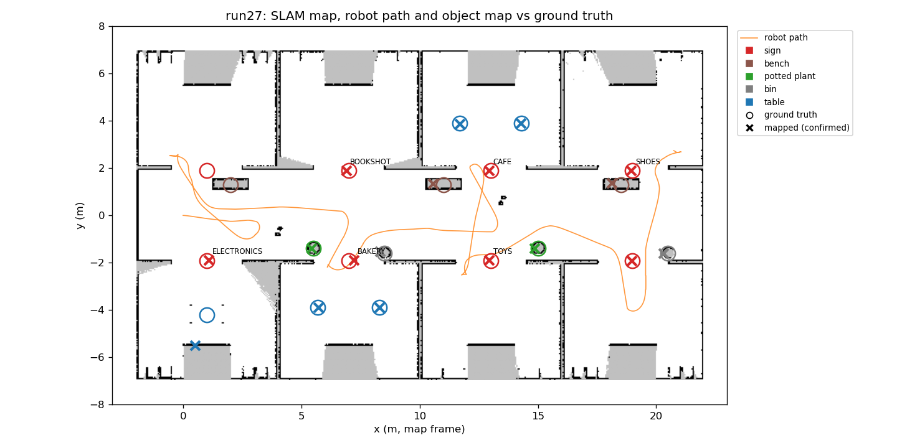
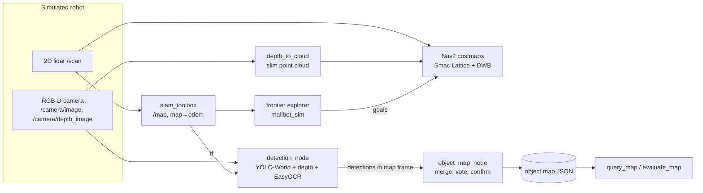
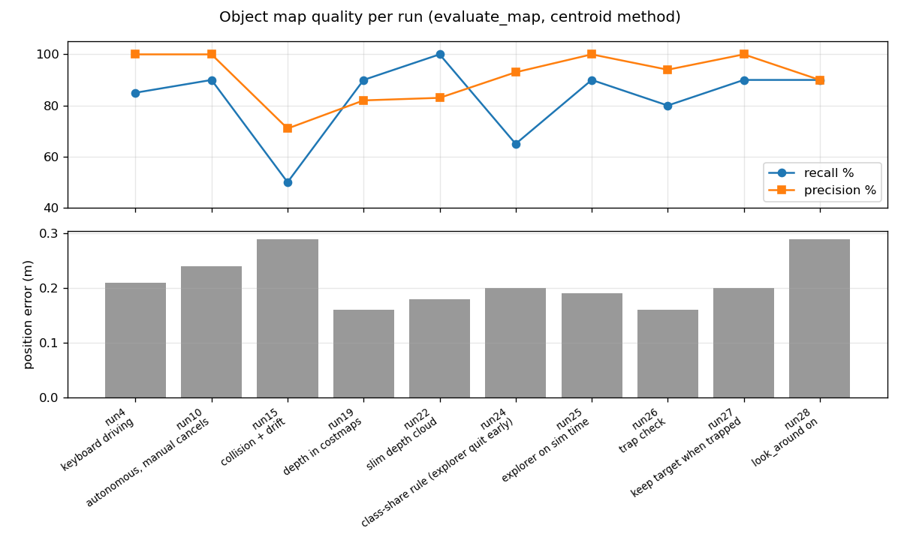
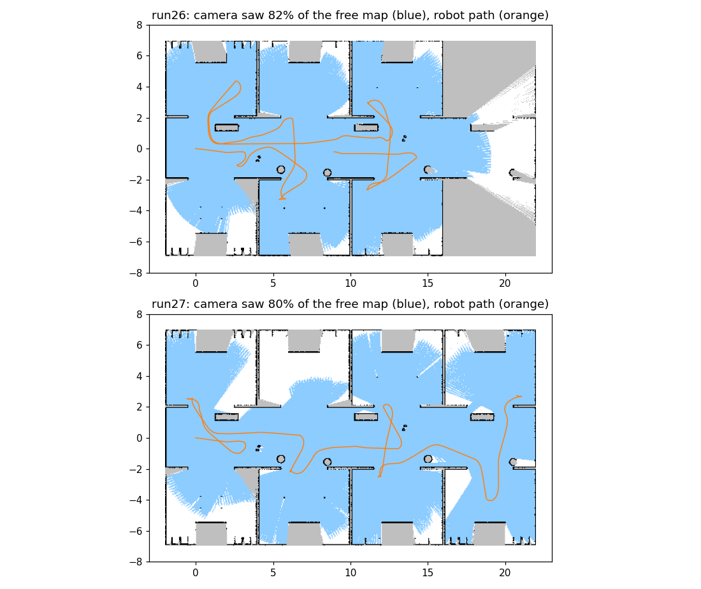

# semantic_mapper

**Online object-level semantic mapping during autonomous exploration** (MSc design project, EN5905,
University of Moratuwa).

A mobile robot explores an unknown indoor mall on its own and, while it drives, builds a map of the
**objects** it sees: signs (with the shop name read by OCR), benches, potted plants, bins and tables,
each with a position in the SLAM map. The map can be queried ("where is the bakery?", "which bin is nearest?").

Everything runs in simulation (ROS 2 Humble, Ignition Gazebo Fortress) on one laptop with an RTX 4060.
This package holds the perception and mapping side; the world, robot, Nav2 setup and the frontier
explorer are in [`mallbot_sim`](https://github.com/naseef139/semantic-mapping-robot).


*run27: SLAM map, robot path (orange), ground truth (circles) and the confirmed object map (crosses,
with the sign text read by OCR). 18 of 20 objects found, no false objects, mean position error 0.20 m.*

## How it works



| Node / tool | What it does |
|---|---|
| `detection_node` | YOLO-World (`yolov8l-worldv2`, open-vocabulary prompts: bench, garbage bin, desk, potted tree, signboard, person) at 1 Hz. Each box gets a 3-D position from the depth image, using the centroid of the object's own pixels (more accurate than the box centre: sign error 0.09 m vs 0.54 m), transformed into the `map` frame. Sign crops go through EasyOCR. |
| `object_map_node` | Merges repeated sightings into objects (per-class merge distances), votes on the class (weighted by confidence) and the sign text. An object is **confirmed** after 3 sightings at least 1 s apart, if its winning class holds ≥ 70% of the vote. Close objects with different labels are fused (one thing seen as two classes). People are never stored, and objects where people stand are removed. Saves JSON every 5 s. |
| `depth_to_cloud` | Turns the depth image into a slim point cloud for the Nav2 costmaps: full resolution for obstacle-height points (0.10–1.0 m, ≤ 3 m), sparse for the rest. It lets the planner see café tabletops that the 2-D lidar misses, at about 16k points per cloud instead of 256k. |
| `query_map` | `ros2 run semantic_mapper query_map <label or shop name> [x y]` → matching confirmed objects, nearest to (x, y) first, with distance (reads `~/mallbot_ws/object_map.json`). |
| `evaluate_map` | Scores an object map against the ground truth in the world file: recall, precision, position error, sign names. |
| `tools/` | Run analysis: `replay_map.py` (replays recorded detections through the mapper offline, to test map rules on old runs in seconds), `perf_log.py`, `nav_bag_check.py`, `plan_clearance_check.py`, `costmap_trap_check.py`, `make_figures.py` (the images here). |

## Running it

```bash
colcon build --symlink-install --packages-select semantic_mapper mallbot_sim
source install/setup.bash
# one autonomous run: sim + SLAM + Nav2 + explorer + detection + object maps + bag
ros2 launch semantic_mapper mapping_run.launch.py run:=run27 rviz:=false   # look_around:=true to spin at each goal
# score it
ros2 run semantic_mapper evaluate_map ~/mallbot_ws/runs/run27/map_centroid.json src/mallbot_sim/worlds/mall_v2.sdf
```

Requirements: ROS 2 Humble, Ignition Fortress, `ultralytics`, `easyocr`, CUDA PyTorch; `numpy<2`
(needed by `cv_bridge`).

## Results so far

The test world is a mall corridor with 8 shops: 20 objects to find (8 signs, 3 benches, 2 plants,
2 bins, 5 tables) and 2 static people that must not be mapped.



| Run | What changed | Recall | Precision | Position error | Sign names |
|---|---|---|---|---|---|
| run4 | keyboard driving (reference) | 85% | 100% | 0.21 m | 5/8 |
| run15 | first autonomous runs: collisions with café tables, SLAM drift | 50% | 71% | 0.29 m | 3/8 |
| run19 | depth camera added to the costmaps | 90% | 82% | 0.16 m | 8/8 |
| run22 | slim depth cloud (controller keeps its 10 Hz loop) | 100% | 83% | 0.18 m | 5/8 |
| run25 | class-share rule + explorer timeouts on sim time | 90% | 100% | 0.19 m | 6/8 |
| run27 | trap check, targets kept when the robot itself is stuck | 90% | 100% | 0.20 m | 5/8 |
| run28 | as run27 with `look_around` (360° spin at each goal) | 90% | 90% | 0.29 m | 5/8 |

What each fix was for, measured before and after:

- **Café tables invisible to the lidar** (thin pole, round top at 0.74 m) caused collisions, wheel slip
  and SLAM drift. The depth camera in both costmaps fixed it: lethal cells at a table went from 2–3 to
  about 360, and there were no SLAM corrections over 5 cm in any run since.
- **CPU:** the full 256k-point cloud made the controller miss its 10 Hz loop 332 times in 5 minutes.
  The slim cloud brought that to 8, and the controller, planner and cloud node together from 159% to
  96% of a core.
- **False objects from mixed class votes** (e.g. the pine plant's pot also seen as a "bin"): the
  class-share rule and the cross-label fuse took precision from 83% to 95–100% when replayed on the
  recorded runs.
- **Exploration ending early:** the explorer's timeouts were on wall time, so on a throttled CPU
  (real-time factor 0.3) a 15 s wait was about 4 s of simulation. They now use sim time. A robot whose
  tail is on a door jamb is freed after 3 s instead of about 26 s, and the target is no longer blamed.
  The image below shows why this matters: in run26 the last east frontier was wrongly blacklisted, so
  the camera never saw the east end; in run27 it covered the whole mall.



## What's next

- **Final experiments (running now):** 5 autonomous runs per configuration from the same start pose,
  (a) baseline and (b) `look_around` on, reporting mean ± sd of recall, precision, position error,
  sign names, exploration time, and stuck/escape events.
- **Path clearance:** 78–92% of plans keep 0.35 m from walls; the target is 95% (mainly at doorway jambs).
- **Sign reading:** 4–6 of 8 names per run; signs are read rarely or at steep angles.
- **Remaining false objects:** confident single-class ones (e.g. a table near the display table).
- **Real-time factor:** runs on this laptop throttle to 0.3–0.6, so all timeouts are kept on sim time.
